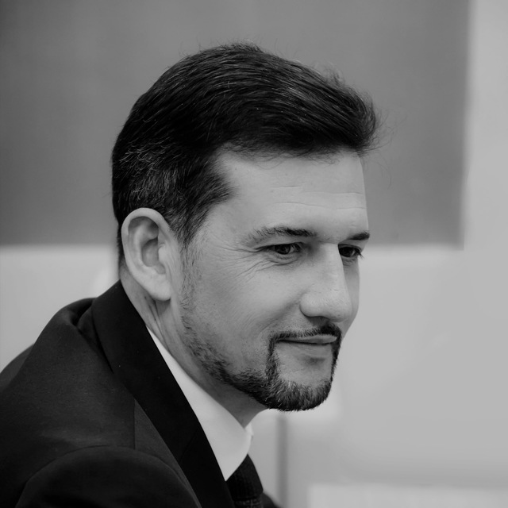

# Дмитрий Колдин

Привет! Я визуализатор из Москвы. Занимаюсь архитектурной визуализацией и автоматизацией в 3ds Max.

## Чем занимаюсь

- Архитектурная визуализация/анимация
- 3ds Max и MaxScript/python
- АГР Моделинг
- Автоматизация: НПМ, ВПМ, ЦИМ

## Навыки

- 3D Max
- Unreal
- Blender

## Ссылки

- GitHub: [@koldindm](https://github.com/koldindm)

